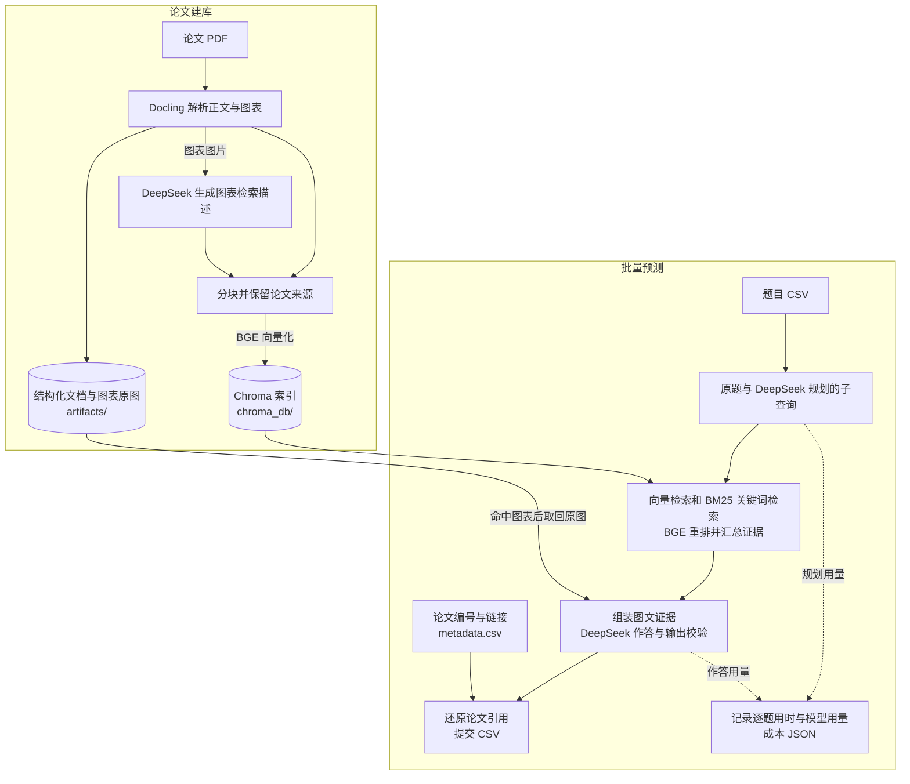

# WattBot Simple

WattBot 2026 多模态检索增强生成（RAG）项目。
解析论文正文、表格和图片，建立本地索引，逐题生成答案与引用，并记录预测成本。

## 项目架构



## 评测结果

使用 `deepseek-flash`，关闭思考。索引覆盖 122 份论文和 12,006 个检索块。

| 数据集 | 完成题数 | 评分方式 | 得分 | 累计答题用时 | 高峰估算费用 | 报告 |
| --- | --- | --- | --- | --- | --- | --- |
| 验证集 | 245 / 245 | 比赛评分器 | **0.8820** | 941.663 秒 | 约 3.630 元 | [验证集评测报告](reports/验证集评测/验证集评测报告.md) |
| 测试集 | 317 / 317 | Kaggle 提交 | **0.867** | 1,369.560 秒 | 约 5.420 元 | [测试集提交报告](reports/测试集提交/测试集提交报告.md) |

报告和评测产物保存在 `reports/`。

## 环境与数据

Python 3.14 或更高版本。首次安装依赖：

```powershell
uv sync --locked
```

锁文件为 Windows x64 固定了 CUDA 13.2 构建 `torch==2.15.0+cu132` 和 `torchvision==0.29.2+cu132`。非 Windows 平台从 PyPI 安装 PyTorch 和 TorchVision。

项目根目录的 `.env` 配置：

```dotenv
DEEPSEEK_API_KEY=填写密钥
```

比赛数据需自行准备，仅保留在本地：

| 路径 | 内容 |
| --- | --- |
| `papers/` | 122 份 PDF，文件名主干对应元数据的 `id` |
| `input/metadata.csv` | 论文清单与来源链接 |
| `input/test_Q.csv` | 317 道测试题 |
| `input/train_QA.csv` | 比赛提供的 245 道带答案的训练题，项目用作验证集 |
| `input/Score.py` | 比赛评分器 |

## 运行

以下命令在项目根目录的 PowerShell 中执行。

建库会解析正文、图片和表格，保存原图和表格截图，并用 `deepseek-flash` 生成图表描述。描述与正文一并写入索引，命中描述后可取回对应原图。

```powershell
.\.venv\Scripts\python.exe -m wattbot_simple.index
```

已有分块的论文会被跳过。要为已有论文生成图表描述，先将 `chroma_db/` 和 `artifacts/` 移到备份位置，再运行同一建库命令。调整答题提示词、检索参数或思考强度时可继续使用现有索引。

使用已有索引预测，默认关闭思考：

```powershell
.\.venv\Scripts\python.exe -m wattbot_simple.predict .\input\test_Q.csv .\submission.csv
```

开启最高思考强度：

```powershell
.\.venv\Scripts\python.exe -m wattbot_simple.predict .\input\test_Q.csv .\submission_max.csv --thinking max
```

`--thinking` 支持 `none`、`low`、`high`、`max`。每题成功后保存成本与答案，失败停止；相同输出文件可按完成前缀续跑。重新评测使用新文件名。

指定题目调试：

```powershell
.\.venv\Scripts\python.exe -m wattbot_simple.predict .\input\test_Q.csv .\submission_debug.csv --ids q002 q005
```

比赛提交须覆盖全部 317 题。`wattbot_simple.main` 可先补齐索引，再按 `predict` 的参数执行预测。

## 成本口径

成本文件为输出文件同目录的 `<文件名>_cost.json`。用时包含检索、重排、证据组织、模型调用和答案处理，不含建库、批次初始化及文件保存。

词元数取自接口回执，费用按固定高峰价格估算：

```text
费用（元）=（缓存命中词元 × 0.04 + 未命中词元 × 2 + 输出词元 × 8）/ 1,000,000
```

失败尝试也计入账目；无用量回执时记为 `null`，累计值只含已知消耗。进程强制终止前未落盘的请求及接口内部重试消耗可能无法完整记录。估算费用不等同于实际账单。
