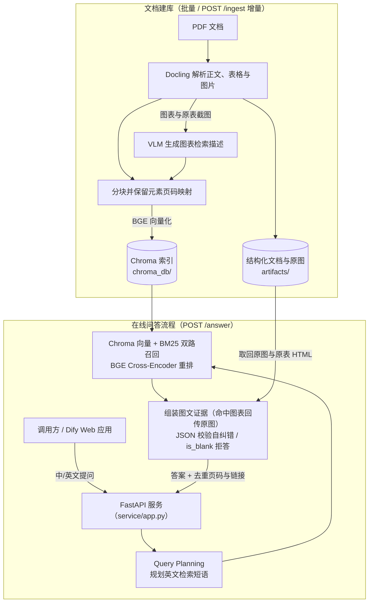

# WattBot Simple

面向复杂技术文档（正文、表格与图表）的多模态检索增强生成（RAG）问答系统。  
支持对本地 PDF 文档库进行图文表解析、混合检索与精确页码溯源，提供 FastAPI 在线问答与增量入库接口，可接入本地 Dify 对话流发布为带 PDF 页码链接的 Web 问答应用，同时也支持离线批量评测。

## 核心特性

- **多模态解析与原图回溯**：使用 Docling 解析 PDF 正文、表格和图片并保留元素页码映射；离线通过视觉模型（VLM）生成图表检索描述入库，问答命中图表时回传原表 HTML 与原图供多模态模型核对。
- **混合检索与结构化校验**：通过 LLM 规划英文检索短语（支持跨语言提问），结合 Chroma 向量检索与 BM25 关键词检索双路召回，经 BGE Cross-Encoder 重排汇总证据；作答阶段执行 JSON 结构化校验与失败自纠错重试，证据不足时返回 `is_blank` 拒答。
- **FastAPI 服务与 Dify 接入**：提供 `/health`、`/answer`（按提问语言作答并聚合去重页码）与 `/ingest`（单篇 PDF 增量入库与索引刷新）接口，可接入本地 Dify 对话流展示带 PDF 页码链接的问答结果。

## 系统架构



## 评测结果

评测配置：`deepseek-flash`（关闭思考），本地索引覆盖 **122 份论文、12,006 个检索块**。

| 数据集 | 完成题数 | 评分方式 | 总分 | 累计用时 / 均题用时 | 估算费用（高峰口径） | 详细报告 |
| --- | --- | --- | --- | --- | --- | --- |
| 验证集（`train_QA.csv`） | 245 / 245 | 比赛评分器 | **0.8820** | 941.66s / 3.84s | 约 3.63 元 | [验证集评测报告](reports/验证集评测/验证集评测报告.md) |
| 测试集（`test_Q.csv`） | 317 / 317 | Kaggle 提交 | **0.867** | 1,369.56s / 4.32s | 约 5.42 元 | [测试集提交报告](reports/测试集提交/测试集提交报告.md) |

**验证集细分维度表现**（见 [score.txt](reports/验证集评测/score.txt)）：
- 表格类题目（Table）：**0.959**（36 / 38）
- 图表类题目（Figure）：**0.912**（15 / 17）
- 引用溯源 F1（Ref F1）：**0.916**（Precision `0.908` / Recall `0.944`）
- 证据不足拒答一致性（NA agreement）：**0.996**
- 测试集输入缓存命中率：**38.035%**

## 项目结构

```text
service/
└── app.py                   # FastAPI 在线问答（/answer）、增量入库（/ingest）与健康检查（/health）
src/wattbot_simple/
├── ingest.py                # Docling 解析、原表截图保存、VLM 图表描述与分块
├── index.py                 # 单篇增量入库与批量建库
├── retrieve.py              # Query Planning、Chroma + BM25 混合召回与 BGE 重排
├── generate.py              # 图文证据组装、JSON 校验自纠错与拒答
├── model.py                 # DeepSeek 模型客户端与图片块编码
├── predict.py               # 离线批量预测、断点续跑与引用还原
├── cost.py                  # 逐题耗时、词元与费用核算
└── main.py                  # 建库与预测组合入口
tests/
├── test_api.py              # FastAPI 接口与增量入库离线单测
└── test_prediction_flow.py  # 检索规划、引用还原、拒答与断点续跑离线单测
```

## 环境准备

需要 **Python 3.14+** 与 **uv**。在项目根目录安装依赖（含 FastAPI / Uvicorn 服务依赖；Windows x64 锁文件固定了 CUDA 13.2 构建 `torch==2.15.0+cu132` 与 `torchvision==0.29.2+cu132`）：

```powershell
uv sync --locked --extra api
```

在项目根目录创建 `.env`：

```dotenv
DEEPSEEK_API_KEY=填写密钥
```

本地数据目录约定（不纳入版本控制）：

| 路径 | 说明 |
| --- | --- |
| `papers/` | PDF 论文目录，文件名主干对应 `metadata.csv` 中的 `id` |
| `input/metadata.csv` | 论文编号与原文链接映射（可选，缺失时仍返回文档编号与页码） |
| `input/train_QA.csv` / `input/test_Q.csv` | 验证集（245 题）与测试集（317 题） |

## 快速开始

### 1. 构建本地索引（首次运行）

解析 `papers/` 中尚未入库的 PDF，保存原图和原表截图，生成图表描述并写入 `chroma_db/`：

```powershell
.\.venv\Scripts\python.exe -m wattbot_simple.index
```

### 2. 启动在线 API 服务

```powershell
.\.venv\Scripts\python.exe -m uvicorn service.app:app --host 0.0.0.0 --port 8000
```

启动后访问 `http://127.0.0.1:8000/docs`：
- `GET /health`：检查服务就绪状态。
- `POST /answer`：接收 `{"question": "...", "answer_unit": "..."}`，按提问语言作答并返回去重排序后的论文链接与 PDF 页码。
- `POST /ingest`：接收 `{"filename": "xxx.pdf", "content_base64": "...", "url": "..."}`，校验 PDF 并增量写入 Chroma，刷新内存 BM25 索引。

### 3. 接入本地 Dify 对话流（可选）

使用 Docker Desktop（WSL 2 + Ubuntu）部署 Dify 1.20.0 时：
1. 在 Dify 的 `.env` 中配置 `SSRF_PROXY_ALLOW_PRIVATE_DOMAINS=host.docker.internal`，允许容器访问宿主机 `8000` 端口。
2. 在 Dify 工作室创建 Chatflow，删除默认 LLM 节点，按以下链路连接（也可通过 OpenAPI 自定义工具直接调用 `wattbot_answer`）：
   ```text
   用户输入 → 模板转换（组装 JSON）→ HTTP 请求（POST http://host.docker.internal:8000/answer）→ 代码执行（格式化 Markdown 来源与页码）→ 直接回复
   ```
3. 发布为 Web App 后，即可用中/英文提问并点击来源链接核对 PDF 对应页码。

## 单元测试

离线运行，不调用外部模型接口：

```powershell
$env:PYTHONPATH="."
.\.venv\Scripts\python.exe -m unittest discover -s tests -v
```

<details>
<summary>离线批量评测与成本核算说明（复现评测数据用，点击展开）</summary>

```powershell
# 默认关闭思考，按已完成前缀支持断点续跑
.\.venv\Scripts\python.exe -m wattbot_simple.predict .\input\test_Q.csv .\submission.csv

# 开启最高思考强度（支持 none / low / high / max）
.\.venv\Scripts\python.exe -m wattbot_simple.predict .\input\test_Q.csv .\submission_max.csv --thinking max

# 指定题号调试
.\.venv\Scripts\python.exe -m wattbot_simple.predict .\input\test_Q.csv .\submission_debug.csv --ids q002 q005
```

批量预测在输出同目录生成 `<文件名>_cost.json`，记录逐题用时（含检索、重排、证据组装、模型调用与输出校验）及词元消耗。估算费用按固定高峰单价计算（失败重试一并计入，仅作开发对比口径）：

```text
费用（元）=（缓存命中词元 × 0.04 + 未命中词元 × 2 + 输出词元 × 8）/ 1,000,000
```

</details>
